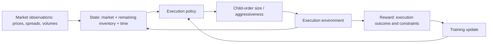
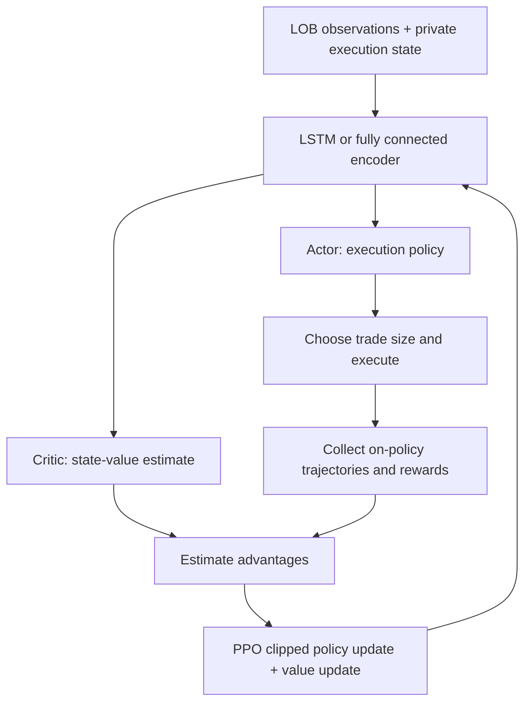

# Undergraduate Project Personal Page

## Optimization of Meta-Order Strategy

**Undergraduate thesis | Cooperation project with Polymer Capital Management (HK) Limited**  
**Oct. 2021 - Jul. 2023** · **羅名志 / NYCU Information Management and Finance**

[Original lab profile](https://nycufinancelab.github.io/LabWebsite/Students/IMF112%E7%BE%85%E6%98%8E%E5%BF%97/) · [Performance evidence](performance-evidence.md)

Research on splitting large institutional orders into smaller trades while balancing execution cost, market impact, inventory risk, and completion deadlines.

## Project contributions

- Developed and evaluated mathematical execution strategies, including volume-weighted average price (VWAP), time-weighted average price (TWAP), Almgren-Chriss, and dynamic programming models under trading constraints.
- Investigated reinforcement learning for adaptive meta-order execution, including a Q-learning agent that adjusts an Almgren-Chriss execution trajectory using time, inventory, spread, and volume information.
- Studied execution strategies for Hong Kong and Japanese equities within the cooperation project; the public implementation slides specifically document Japan Tobacco (2914.T).
- Reviewed PPO-based end-to-end execution with limit-order-book inputs, LSTM and fully connected networks, and shaped rewards.

The cooperation, project dates, and broader Hong Kong/Japan scope above were supplied by the project author. The public slides substantiate Japanese-equity examples. The source set contains research presentations and implementation summaries; this repository does not include an executable trading system or private market data.

## Mathematical foundations

| Approach | Role in execution research |
| --- | --- |
| TWAP | Splits volume equally over the execution horizon |
| VWAP | Allocates volume according to a market-volume profile |
| Almgren-Chriss | Balances expected execution cost and cost variance through risk aversion |
| Bertsimas-Lo | Uses dynamic programming with price impact and information variables |
| Resilient limit-order-book model | Accounts for order-book shape and recovery after trading |
| Hybrid AC + Q-learning | Learns a multiplier on the AC-suggested trade size |
| PPO | Learns a policy directly from order-book and investor state |

These are approaches covered in the materials, rather than a claim that every approach was deployed or independently validated in production.

## Reinforcement learning workflow

**Implemented hybrid route:** a tabular Q-learning policy chooses a multiplier on the AC baseline, rather than learning the entire schedule from scratch. The documented multiplier range is 0 to 2, in increments of 0.25.

**PPO literature route:** a policy network uses the top five bid/ask prices and volumes together with inventory and elapsed time. The reviewed framework compares LSTM and fully connected architectures. PPO constrains policy changes through a clipped objective, helping stabilize training. This is a conceptual explanation of the reviewed method, not evidence that a PPO implementation was completed in the cooperation project.

References: [PPO, Schulman et al.](https://arxiv.org/abs/1707.06347) and the linked presentation of Lin and Beling's 2020 end-to-end trade-execution framework. The PPO presentation is dated **September 15, 2023**, after the stated thesis period, and is presented here as a subsequent research review.

## Results and measurement

The public documents do **not establish an over-15% improvement from this project's reinforcement learning implementation**. They do contain numerical implementation results, plus separately attributed results from earlier literature.

| Evidence | Documented result | Interpretation |
| --- | --- | --- |
| Project hybrid RL experiment, 2914.T | Mixed mean IS outcomes against AC; see detailed table | No defensible single improvement percentage |
| Project AC daily comparison | 41,759,718.42 vs 45,870,027.80 realized trading cost | About **8.96% lower cost** in this specific displayed example; mathematical baseline, not RL |
| Project one-sided LOB example | 5,330,667 vs 5,497,500 modeled impact cost | About **3.03% lower modeled cost**, excluding fixed costs; illustrative, not RL |
| Hendricks-Wilcox research reviewed in slides | 4.8% IS improvement | Prior literature, not this project's result |
| Nevmyvaka-Feng-Kearns research reviewed in slides | 27.16%-35.50% in a private-state comparison; up to 50% or more elsewhere | Prior literature against submit-and-leave, not this project's result |
| PPO research presentation | Mean difference from TWAP, IS standard deviation, gain-loss ratio | Tabulated values are not percentage improvement figures |

The derived 8.96% and 3.03% figures use `(baseline cost - strategy cost) / baseline cost × 100`, calculated from displayed slide values. They are narrow examples, not aggregate out-of-sample estimates. See [the evidence audit](performance-evidence.md) for sign conventions, limitations, and source locations.

## Research documents

- [0913.pptx](https://nycufinancelab.github.io/LabWebsite/Students/IMF112%E7%BE%85%E6%98%8E%E5%BF%97/0913.pptx)
- [A reinforcement learning extension to the Almgren-Chriss framework for optimal trade execution.pdf](https://nycufinancelab.github.io/LabWebsite/Students/IMF112%E7%BE%85%E6%98%8E%E5%BF%97/A%20reinforcement%20learning%20extension%20to%20the%20Almgren-Chriss%20framework%20for%20optimal%20trade%20execution.pdf)
- [OPTIMAL EXECUTION IN A GENERAL ONE-SIDED LIMIT-ORDER BOOK.pdf](https://nycufinancelab.github.io/LabWebsite/Students/IMF112%E7%BE%85%E6%98%8E%E5%BF%97/OPTIMAL%20EXECUTION%20IN%20A%20GENERAL%20ONE-SIDED%20LIMIT-ORDER%20BOOK.pdf)
- [Optimal Execution of Portfolio Transactions.pdf](https://nycufinancelab.github.io/LabWebsite/Students/IMF112%E7%BE%85%E6%98%8E%E5%BF%97/Optimal%20Execution%20of%20Portfolio%20Transactions.pdf)
- [Optimal control of execution costs.pdf](https://nycufinancelab.github.io/LabWebsite/Students/IMF112%E7%BE%85%E6%98%8E%E5%BF%97/Optimal%20control%20of%20execution%20costs.pdf)
- [Reinforcement Learning for Optimized Trade Execution.pdf](https://nycufinancelab.github.io/LabWebsite/Students/IMF112%E7%BE%85%E6%98%8E%E5%BF%97/Reinforcement%20Learning%20for%20Optimized%20Trade%20Execution.pdf)

## Suggested CV description

**Undergraduate Thesis - Cooperation Project with Polymer Capital Management (HK) Limited | Oct. 2021 - Jul. 2023**  
*Optimization of Meta-Order Strategy*

- Developed mathematical execution benchmarks, including VWAP and Almgren-Chriss, to evaluate institutional order execution under market-impact, inventory, and timing constraints.
- Investigated reinforcement learning strategies for adaptive meta-order execution, implementing an Almgren-Chriss/Q-learning approach on Japanese-equity data and reviewing PPO-based limit-order-book policies.

A quantified RL accomplishment should be added only when an evaluation identifies the metric, baseline, test period, sample size, costs, and reproducible result supporting it.

## Repository contents

- `README.md`: project overview and conceptual RL/PPO diagrams.
- `performance-evidence.md`: detailed audit of reported metrics.
- `index.html`: portable personal page, retaining links to the original lab-hosted assets.

Original research materials remain linked at their existing lab URLs. No private datasets or proprietary trading code are included.
